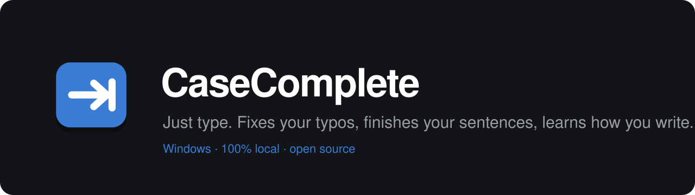
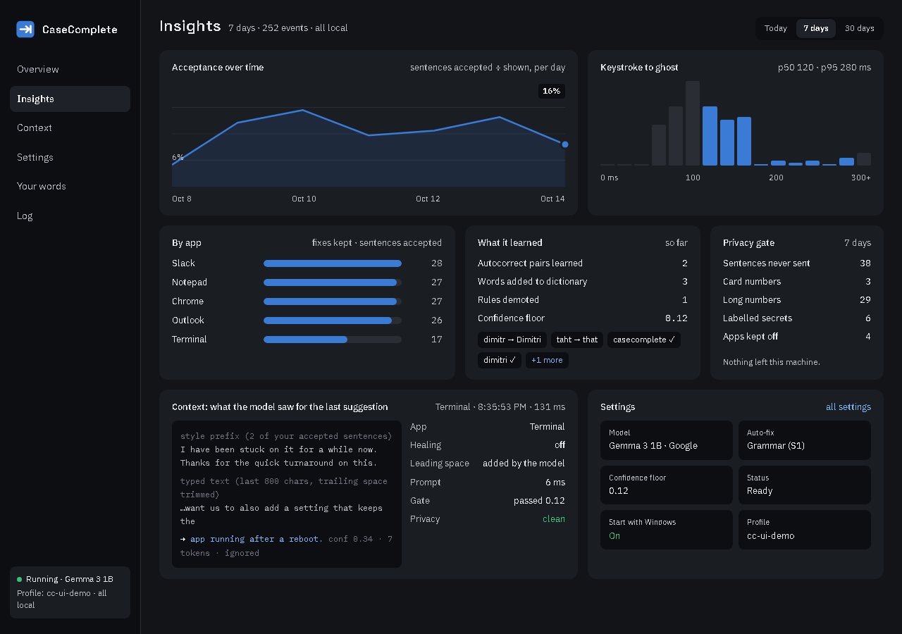

<p align="center">
  <a href="https://github.com/drknowhow/casecomplete"></a>
</p>

<p align="center">
  <a href="https://github.com/drknowhow/casecomplete/releases/latest"></a>
  <a href="https://github.com/drknowhow/casecomplete/actions/workflows/ci.yml"></a>
  <a href="LICENSE"></a>
  
  
</p>

<p align="center">
  <b>A typing assistant for Windows that fixes your typos as you go, finishes your sentences, and learns how you write.</b><br>
  Everything runs on your own computer. No account, no cloud, no telemetry.
</p>

<p align="center">
  <a href="https://github.com/drknowhow/casecomplete/releases/latest"><b>Download the installer</b></a> ·
  <a href="#how-it-works">How it works</a> ·
  <a href="#privacy">Privacy</a> ·
  <a href="#build-from-source">Build</a> ·
  <a href="docs/research-and-architecture.md">Architecture</a>
</p>

## How it works

| | |
|---|---|
| **Fixes typos on the space bar** | `thhe` becomes `the`, `becuase` becomes `because`, the instant you finish the word. A brief blue underline shows what moved. Press `←` within 3 seconds to undo. |
| **Finishes your sentences** | Pause for a moment and grey ghost text completes the sentence. `Tab` accepts it and offers the next one. `Ctrl+Tab` takes one word. `Esc` dismisses. |
| **Learns how you write** | Retype a word you just closed and the pair becomes an autocorrect entry. Undo a fix twice and the word joins your dictionary. Rules you keep undoing stop auto-applying. |
| **Works everywhere** | Mail, chat, browsers, editors, terminals. It was built with Claude Code's prompt in mind. |
| **Keeps your secrets** | Card numbers, SSNs, IBANs, account numbers and `password:` style secrets never reach the model. Banking and health sites are off by default. |

A tray icon opens a flyout with today's numbers and the switches. The dashboard shows acceptance over time, latency, per-app stats, what it learned, and exactly what the model saw for the last suggestion.

<p align="center">
  
</p>

## Install

1. Download `CaseComplete-<version>.msi` from the [latest release](https://github.com/drknowhow/casecomplete/releases/latest) and run it. It installs for your user only (no admin) and adds a Start Menu entry.
2. On first start it downloads the inference engine ([llama.cpp](https://github.com/ggml-org/llama.cpp)) and the default model, Gemma 3 1B (about 1 GB), into `%LOCALAPPDATA%\CaseComplete`.
3. Click the tray icon. Turn on **Start with Windows** in Settings if you want it always there.

An NVIDIA GPU gives about 120 ms from keystroke to suggestion. On CPU, pick SmolLM2 360M in the Model menu.

Requirements: Windows 11 (Windows 10 should work), the WebView2 runtime (included with Windows 11).

## Models

Models are downloaded at first run from Hugging Face and are not part of this repository. Switch from the tray menu or the dashboard.

| Model | Maker | License | Notes |
|---|---|---|---|
| Gemma 3 1B (default) | Google | [Gemma Terms of Use](https://ai.google.dev/gemma/terms) | best quality per millisecond on a GPU |
| SmolLM2 360M | Hugging Face | Apache-2.0 | fastest, fine on CPU |
| Qwen2.5 1.5B | Alibaba | Apache-2.0 | alternative |

Spelling and grammar use [Harper](https://github.com/Automattic/harper) (Apache-2.0) in-process; no model needed, about 2 ms per check.

## Privacy

Everything is local. The only network calls are the one-time downloads of llama.cpp (GitHub) and the model (Hugging Face).

- Text with a card number, SSN, IBAN, a long digit run, or a secret after a label such as `password:` gets no completion, no fix, and no log entry.
- `privacy.toml` in your profile lists apps and window-title fragments where the assistant stays off (banking, health portals, password managers by default). Edit it freely.
- The event log keeps typos and their fixes and the text of accepted suggestions. The sentence around a fix is stored only if you set `store_context = true`.
- Profile data lives in `%LOCALAPPDATA%\CaseComplete\profiles\default`. Delete the folder and it forgets everything.

## Build from source

Requires Rust 1.93 or newer. The installer needs the WiX 5 dotnet tool: `dotnet tool install --global wix --version 5.0.2`.

```
cargo build --release
powershell -File installer\build.ps1     # builds installer\out\CaseComplete-<version>.msi
```

`CC_CONSOLE=1` opens a console with the log; otherwise the log is `%LOCALAPPDATA%\CaseComplete\casecomplete.log`. Other knobs: `CC_MODEL`, `CC_MIN_CONFIDENCE`, `CC_AUTO_APPLY_UP_TO` (`off|S0|S1|S2`), `CC_FIX_INJECT` (`keys|slow|paste|fast`).

### Layout

| Crate | Role |
|---|---|
| `cc-hook` | low-level keyboard hook, shadow buffer, key capture during injection |
| `cc-context` | UI Automation: caret position, text before the caret, focused app |
| `cc-engine` | llama-server sidecar, model download, streaming completions |
| `cc-correct` | Harper-based checker with severity levels, autocorrect list, dictionary |
| `cc-overlay` | ghost-text overlay window (Direct2D) |
| `cc-inject` | SendInput and clipboard injection strategies |
| `cc-store` | `events.db`: every fix and suggestion with its outcome; tuning |
| `cc-ui` | local web UI (flyout and dashboard) and JSON API |
| `cc-window` | WebView2 windows for the UI |
| `cc-tray` | tray icon and menu |
| `cc-app` | the orchestrator |
| `tools/bench` | next-word accuracy and latency across models |
| `promo` | the Remotion promo video |

Design notes: [research and architecture](docs/research-and-architecture.md), [plan](docs/PLAN.md), [brand](docs/brand).

## Roadmap

- Per-app overrides (insertion strategy, context source)
- Tier-2 sentence rewrite on a pause, suggest-only
- Fine-tuning the completion model on your own writing (LoRA), locally
- A bench on your own text to pick the model that knows your voice

## Contributing

Issues and pull requests are welcome. See [CONTRIBUTING.md](CONTRIBUTING.md). Security reports: [SECURITY.md](SECURITY.md).

## License

MIT. See [LICENSE](LICENSE).
