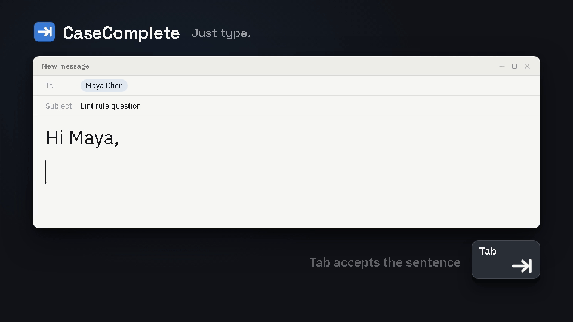

# CaseComplete

**Just type.** A Windows typing assistant that fixes your typos as you go, finishes your sentences, and learns how you write. It runs entirely on your computer.



## What it does

- **Fixes typos the moment you hit space.** `thhe` becomes `the`, `becuase` becomes `because`. A brief blue underline shows what moved. Left arrow within 3 seconds undoes it.
- **Finishes your sentences.** Grey ghost text appears while you pause. `Tab` accepts the sentence and offers the next one; `Ctrl+Tab` takes one word; `Esc` dismisses.
- **Learns from you.** Retype a word you just closed and the pair becomes an autocorrect entry. Undo a fix twice and the word joins your dictionary. Rules you keep undoing stop auto-applying.
- **Works everywhere you type.** Mail, chat, browsers, editors, and terminals (it was built with Claude Code's prompt in mind).
- **Keeps your secrets.** Card numbers, SSNs, IBANs, long account numbers and `password:` style secrets never reach the model. Banking and health sites are off by default (`privacy.toml`). Nothing leaves the machine.

A tray icon gives you a flyout with today's numbers and the switches; the dashboard shows acceptance over time, latency, per-app stats, what it learned, and exactly what the model saw for the last suggestion.

## Install

Download the latest `CaseComplete-<version>.msi` from Releases and run it. It installs for your user only (no admin), adds a Start Menu entry, and can start with Windows (Settings in the dashboard).

On first start it downloads the inference engine (llama.cpp) and the default model, Gemma 3 1B (about 1 GB), into `%LOCALAPPDATA%\CaseComplete`. An NVIDIA GPU makes it fast (about 120 ms from keystroke to suggestion); it also runs on CPU with a smaller model.

Requirements: Windows 11 (10 should work), the WebView2 runtime (already on Windows 11).

## Models

Models are downloaded at first run from Hugging Face and are not part of this repository.

| Model | Maker | License |
|---|---|---|
| Gemma 3 1B (default) | Google | [Gemma Terms of Use](https://ai.google.dev/gemma/terms) |
| SmolLM2 360M | Hugging Face | Apache-2.0 |
| Qwen2.5 1.5B | Alibaba | Apache-2.0 |

Switch models from the tray menu or the dashboard. Grammar and spelling checks use [Harper](https://github.com/Automattic/harper) (Apache-2.0), in-process, no model needed. Inference runs on [llama.cpp](https://github.com/ggml-org/llama.cpp) (MIT).

## Build from source

Requires Rust 1.93+ and, for the installer, the WiX 5 dotnet tool (`dotnet tool install --global wix --version 5.0.2`).

```
cargo build --release
.\target\release\casecomplete.exe          # or wherever your target dir is
powershell -File installer\build.ps1       # builds installer\out\CaseComplete-<version>.msi
```

Set `CC_CONSOLE=1` to get a console with the log; otherwise the log is `%LOCALAPPDATA%\CaseComplete\casecomplete.log`.

Useful knobs (environment variables): `CC_MODEL`, `CC_MIN_CONFIDENCE`, `CC_AUTO_APPLY_UP_TO` (`off|S0|S1|S2`), `CC_FIX_INJECT` (`keys|slow|paste|fast`).

## Layout

| Crate | Role |
|---|---|
| `cc-hook` | low-level keyboard hook, shadow buffer, key capture during injection |
| `cc-context` | UI Automation: caret position, text before the caret, focused app |
| `cc-engine` | llama-server sidecar, model download, streaming completions |
| `cc-correct` | Harper-based checker with severity levels, autocorrect list, dictionary |
| `cc-overlay` | ghost-text overlay window (Direct2D) |
| `cc-inject` | SendInput and clipboard injection strategies |
| `cc-store` | `events.db`: every fix and suggestion with its outcome; tuning |
| `cc-ui` | local web UI (flyout and dashboard) and JSON API |
| `cc-window` | WebView2 windows for the UI |
| `cc-tray` | tray icon and menu |
| `cc-app` | the orchestrator |
| `tools/bench` | next-word accuracy and latency across models |
| `promo` | the Remotion promo video |

Design notes: `docs/research-and-architecture.md` and `docs/PLAN.md`.

## Privacy

Everything is local. The only network calls are the one-time downloads of llama.cpp (GitHub) and the model (Hugging Face). The event log stores typos and their fixes and the text of accepted suggestions; the sentence around a fix is stored only if you set `store_context = true` in `privacy.toml`. Profile data lives in `%LOCALAPPDATA%\CaseComplete\profiles\default`.

## License

MIT. See `LICENSE`.
